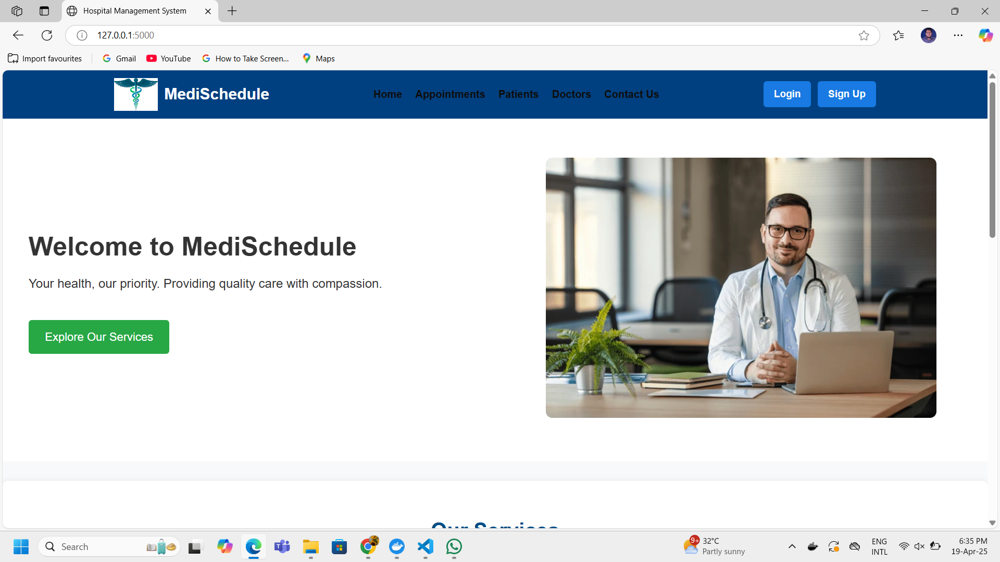
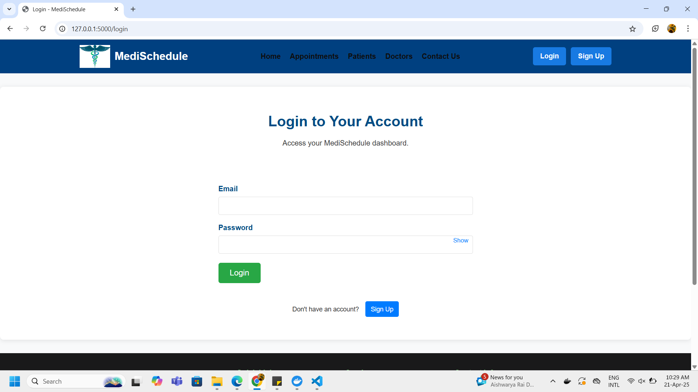
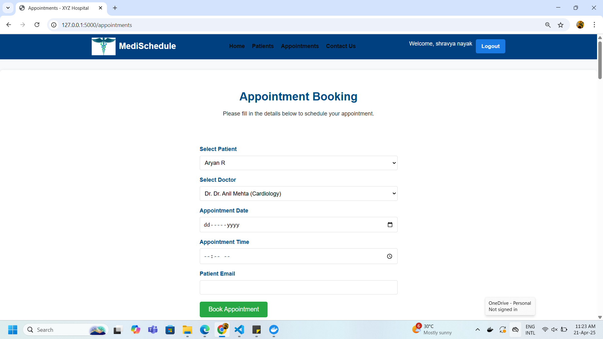
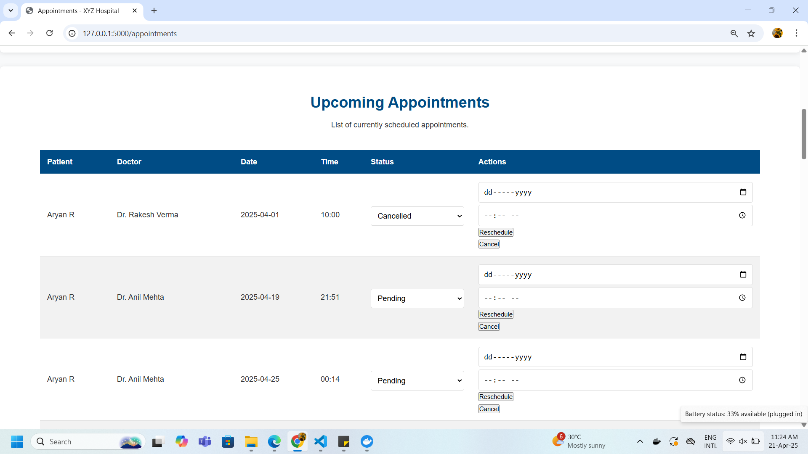

# 🩺 Doctor Appointment System


<p align="center">
  
</p>

A full-stack web application built using **Flask (Python)**, **MySQL**, **HTML**, and **CSS**, designed to streamline the process of booking and managing doctor appointments. This role-based system supports **Patients**, **Doctors**, and **Admins**, offering features like appointment scheduling, status tracking, profile management, and email notifications.

---
## 🛠️ Built With

<p align="left">
  <!-- Languages & Frameworks -->
  
  
  
  

  <!-- Frontend -->
  
  

  <!-- Database -->
  

  <!-- Tools -->
  
  
  
</p>

---

## 💻 Backend Tech Stack Overview

### 🐍 Programming Language & Framework

- **[Python](https://www.python.org/)** - High-level, interpreted programming language known for its simplicity, readability, and vast ecosystem of libraries
- **[Flask 3.1.0](https://flask.palletsprojects.com/)** – Lightweight web framework for building the backend
- **[Flask-CORS 5.0.1](https://flask-cors.readthedocs.io/)** – Enables Cross-Origin Resource Sharing (CORS)  
- **[Gunicorn 21.2.0](https://docs.gunicorn.org/en/stable/)** – WSGI HTTP server used for deployment in production (render) 

---

### 🔐 Security & Utilities

- **[itsdangerous 2.2.0](https://itsdangerous.palletsprojects.com/)** – For secure data signing (used in Flask sessions)
- **[cryptography 44.0.2](https://cryptography.io/en/latest/)** – Provides cryptographic recipes and primitives
- **[blinker 1.9.0](https://pythonhosted.org/blinker/)** – Provides fast and simple object-to-object and broadcast signaling  

---

### ⚙️ Web Utilities

- **[Werkzeug 3.1.3](https://werkzeug.palletsprojects.com/)** – WSGI utility library used under the hood in Flask
- **[Jinja2 3.1.6](https://jinja.palletsprojects.com/)** – Template engine for Python, used by Flask
- **[MarkupSafe 3.0.2](https://markupsafe.palletsprojects.com/)** – Safely handles strings in Jinja templates  
- **[Click 8.1.8](https://click.palletsprojects.com/)** – Command-line utility library (used by Flask CLI)  
- **[colorama 0.4.6](https://pypi.org/project/colorama/)** – For cross-platform terminal color formatting

---

### 🗃️ Database Stack

- **[PyMySQL 1.1.1](https://pymysql.readthedocs.io/)** – Pure Python MySQL client 
- **[mysql-connector 2.2.9](https://dev.mysql.com/doc/connector-python/en/)** – Oracle's official MySQL client for Python  
- **[mysqlclient 2.2.7](https://mysqlclient.readthedocs.io/)** – Fast MySQL client written in C (recommended for production)  
- **[mysql 0.0.3](https://pypi.org/project/mysql/)** – Wrapper (not commonly used; possibly a placeholder or meta-package)  

> ⚠️ **Note:** You don’t need all 4 MySQL clients. Pick one based on your usage:  
> - For Flask + SQLAlchemy, use `mysqlclient` or `PyMySQL`  
> - For pure MySQL without ORM, `mysql-connector` or `PyMySQL` is enough  

---

### 🔧 System & Dependency Utilities

- **[cffi 1.17.1](https://cffi.readthedocs.io/)** – Required for low-level system calls, often a dependency of `cryptography`
- **[pycparser 2.22](https://github.com/eliben/pycparser)** – C parser used by `cffi`
- **[importlib_metadata 8.6.1](https://importlib-metadata.readthedocs.io/)** – Access to package metadata  
- **[zipp 3.21.0](https://zipp.readthedocs.io/)** – A pathlib-compatible zipfile wrapper  

---

## 🚀 Features

### 🔐 Role-Based Authentication
- Patients, Doctors, and Admins can register and securely log in
- Each user has access only to role-appropriate features

### 📅 Appointment Management
- **Patients**: Book, reschedule, and cancel appointments
- **Doctors**: View and update appointments
- **Admins**: Full access to all appointments and user data

### 🔄 Appointment Status Tracking
- Statuses include: `Pending`, `Completed`, `Cancelled`, and `Missed`

### 📧 Email Notifications
- Real-time email alerts for:
  - Appointment confirmation  
  - Rescheduling updates  
  - Cancellations  
- Powered by **Flask-Mail** with Gmail SMTP

### 🌐 Responsive Frontend
- Clean and user-friendly interface using custom **HTML & CSS**
- Fully responsive across devices

---

## 🛠️ Tech Stack

| Layer             | Technology                                                                                      |
|-------------------|------------------------------------------------------------------------------------------------|
| **Backend**       |   |
| **Frontend**      |       |
| **Database**      |       |
| **Email Service** |  
| **Version Control** |           |

---

## ⚙️ Installation Guide

### 📋 Prerequisites
- Python 3.8+
- MySQL Server
- Git
- Docker (optional, for containerized setup)
  
### 1. 📥 Clone the Repository
```bash
git clone https://github.com/shravyamnayak/dbms-project.git
cd dbms-project
```

### 2. 🧪 Set Up a Virtual Environment (Optional)
```bash
python -m venv venv
# On Linux/macOS
source venv/bin/activate

# On Windows
venv\Scripts\activate
```

### 3. 📦 Install Dependencies
```bash
pip install -r requirements.txt
```

### 4. 🗃️ Configure the MySQL Database
- Create a MySQL database named `doctors_appointment`
- Ensure all required tables are created based on the schema

### 5. ✉️ Configure Flask-Mail

```python
MAIL_SERVER = 'smtp.gmail.com'
MAIL_PORT = 587
MAIL_USE_TLS = True
MAIL_USERNAME = 'your-email@gmail.com'
MAIL_PASSWORD = 'your-app-password'
```

### 6. ▶️ Run the App
```bash
flask run
```

Access the app at: [http://127.0.0.1:5000](http://127.0.0.1:5000)

---

## 🐳 Run with Docker (Optional)
Easily spin up the entire application stack using Docker for quick setup and deployment:

**⚙️ Prerequisites:**
Ensure Docker and Docker Compose are installed and running on your system.

**🚀 Launch the App:**
```bash
docker-compose up --build
```
Once it’s up, open your browser and visit:
👉 http://localhost:5000

📦 What’s Included:
- **🐍 Flask Backend** – Serves the web app
- **🐬 MySQL Database** – Stores all appointment and user data

Docker handles all dependencies and setup, making the project portable and easy to run anywhere.

--- 

## 🖼️ Project Screenshots

Here are some key screens from the **Doctor Appointment System** showcasing the main features and UI:

<table>
  <tr>
    <td align="center" style="padding: 15px;">
      
      <br/>
      <strong>🏠 Home Page</strong>
      <p style="max-width: 280px; color: #555; font-style: italic; font-size: 0.9em;">
        Welcome screen with navigation to key features and quick info.
      </p>
    </td>
    <td align="center" style="padding: 15px;">
      
      <br/>
      <strong>🔐 Login Page</strong>
      <p style="max-width: 280px; color: #555; font-style: italic; font-size: 0.9em;">
        Secure login with email and password authentication.
      </p>
    </td>
  </tr>
  <tr>
    <td align="center" style="padding: 15px;">
      
      <br/>
      <strong>📅 Appointment Dashboard</strong>
      <p style="max-width: 280px; color: #555; font-style: italic; font-size: 0.9em;">
        View and manage your scheduled appointments easily.
      </p>
    </td>
    <td align="center" style="padding: 15px;">
      
      <br/>
      <strong>🔄 Reschedule Page</strong>
      <p style="max-width: 280px; color: #555; font-style: italic; font-size: 0.9em;">
        Easily reschedule appointments with just a few clicks.
      </p>
    </td>
  </tr>
</table>

---

## 🤝 Contributing
Contributions are welcome!
Feel free to open issues for bugs or feature requests, or submit pull requests.

Please adhere to the existing code style and add tests when applicable.

 ---
 
## 🌟 Future Enhancements

- 📱 **Mobile App Integration**: Cross-platform mobile apps for patients and doctors
- 🔍 **Advanced Search & Filters**: Filter by specialization, date, and availability
- ⭐ **Ratings & Feedback**: Let patients rate and review doctors
- 💳 **Payment Integration**: Secure online payments for consultations

---

## 📫 Contact
GitHub: shravyamnayak

Email: shravyamnayak@gmail.com

---
## 📄 License

This project is licensed under the **MIT License**.  
See the [LICENSE.md](LICENSE.md) file for details.

---
